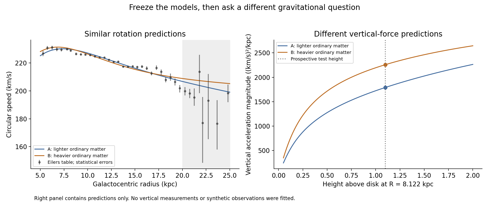

# Similar rotation curves, different vertical gravity

October 9, 2026 · Third experiment in the Oort–halo inquiry

Two already-fitted mass models predict similar Milky Way rotation curves, but different gravity above the disk. A different gravitational observable could therefore help distinguish these distributions. This is a prospective diagnostic, not a new observational result.



## Freeze before comparison

We select the previous sensitivity fits with ordinary-matter mass normalizations 0.8 and 1.2. Both used the published rotation bins below 20 kpc and the same illustrative 3% weighting floor. Their halo parameters are copied from results.json, not fitted again. All ordinary-matter components, including gas and bulge, scale together; their shapes are preserved.

The prospective test point is fixed at Galactocentric radius 8.122 kpc and height 1.1 kpc above the Galactic midplane. We calculate the magnitude of vertical acceleration, |K_z|=|−∂Φ/∂z|, from each axisymmetric potential.

No new vertical-force dataset was consulted. The plan, selected fits, and their checksums are recorded in discrimination-plan.json and discrimination-results.json. This is a local freeze record, not a timestamped external preregistration.

| Quantity | Model A: lighter ordinary matter | Model B: heavier ordinary matter |
|---|---:|---:|
| Ordinary-matter mass scale | 0.8 | 1.2 |
| Halo scale radius (kpc) | 7.83 | 27.13 |
| Rotation-fit RMS residual (km/s) | 1.96 | 2.28 |
| Predicted vertical acceleration ((km/s)²/kpc) | 1792.06 | 2258.55 |
| Force-equivalent surface density (solar masses/pc²) | 66.30 | 83.56 |

The largest difference between their rotation predictions over the sampled 5–20 kpc grid is 2.97 km/s. The vertical-force gap is 466.48 (km/s)²/kpc, or **23.0% of the mean prediction**.

Force-equivalent surface density means |K_z|/(2πG), expressed in solar masses/pc². It is a convenient unit conversion. It is not the actual integrated column density: relating the two requires the radial term of Poisson's equation, as well as the chosen geometry.

## Why the predictions separate

Rotation probes the radial potential gradient in the midplane. Vertical motions probe a different derivative away from it. Moving the allocation of mass between a flattened disk and a spherical halo can preserve the radial gradient approximately while changing the vertical one. The models therefore need not make the same prediction for vertical stellar dynamics.

They are not exactly degenerate. A sufficiently informative rotation dataset and adequate treatment of systematics might distinguish them already. We have not calculated posterior odds or statistically established that the two are indistinguishable.

## A design illustration, not a detection claim

If a vertical-force estimate had a known Gaussian total standard deviation of 5% of the midpoint prediction, the prediction gap would be 4.61 such standard deviations. That number describes a hypothetical measurement design. It is not an observed significance, a probability of correct classification, or a claim about attainable precision. Uncertainty in the mass-model shapes is also omitted from this illustration.

Before using real data, we must inspect how the vertical force was inferred: tracer selection, distance calibration, equilibrium assumptions, radial–vertical velocity correlations, and nuisance covariance can matter. The originally published McMillan parameters also used dynamical constraints. An overlapping vertical dataset would not be an independent validation; we must audit those shared data and priors explicitly.

## Decision rule for a real comparison

1. Select and document a vertical-dynamics dataset and its overlap with the baseline's original constraints.
2. Use its published likelihood and uncertainty model wherever available; compare consistent radius, height, and midplane definitions.
3. Evaluate the two frozen predictions without retuning them.
4. Report whether either prediction fits, whether both remain admissible, or whether both fail. Failure of both calls the shared assumptions into question.
5. Any revised model is a new model. Document the change and evaluate its forecasts on additional observations before calling it predictive progress.

The meaningful result would be learning which mass-distribution assumptions survive. It would not establish that NFW is the true profile or identify the microscopic constituent of a halo.

## Relation to the working thesis

This experiment addresses what one dataset does not identify, and whether another observable can supply some missing information. The accompanying working-propositions.md preserves a separate conditional theorem: descriptions producing the same effective density field and gravitational boundary conditions yield the same force in our Newtonian continuum model. Gravity of that field cannot by itself decide which microscopic label produced it.

That theorem does not imply equality of every candidate's predictions, or permanent undetectability. Permanent observational equivalence remains a stronger conjecture requiring a defined class of theories and allowed experiments.

## Reproduce

Using the previous study's environment and pinned requirements:

```sh
.venv/bin/python discrimination.py
```

Inputs: results.json, eilers-2019-table1.csv, and discrimination-plan.json. Outputs: discrimination-results.json, frozen-rotation-predictions.csv, vertical-predictions.csv, and discrimination.png/pdf. No network access is needed for reruns.

Checks passed: numerical vertical potential derivative against the force, zero force in the midplane, reflection symmetry above/below the disk, and the spherical NFW vertical force against its analytic enclosed-mass formula. The figure was visually inspected.

This supporting calculation is now published with working paper 01. The previously published real-data comparison remains at https://rmichaelglover.github.io/hrl-portfolio/oort-halo/milky-way/.
