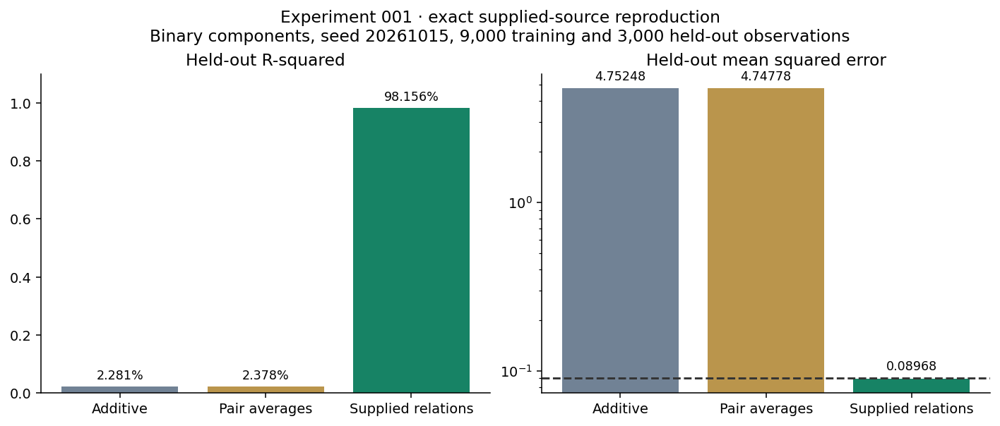
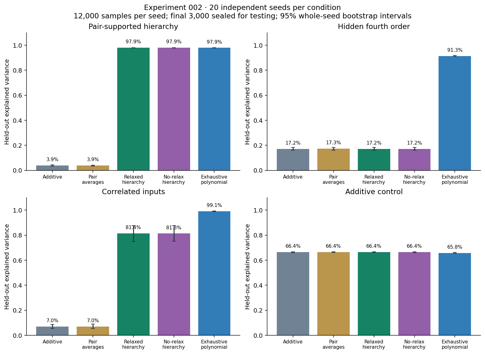
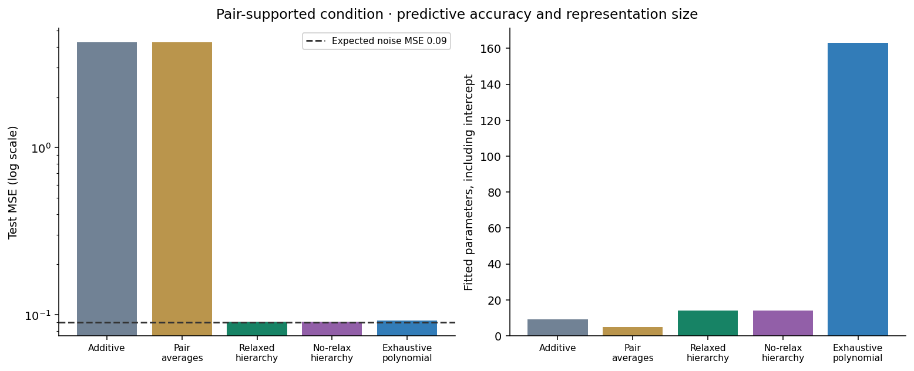
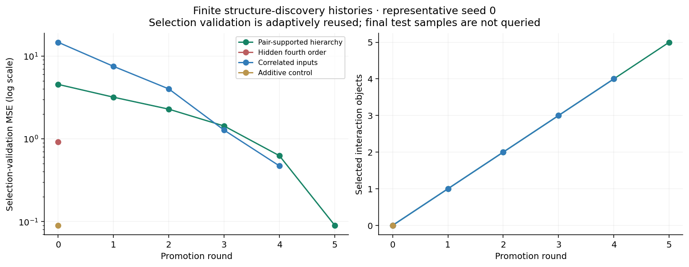

# Meta-Renormalization: Experiment 002
## Autonomous interaction discovery within an explicit candidate grammar

R. Michael Glover · HRL Portfolio · October 2026 · Seeded synthetic experiment

### Abstract

Experiment 001 supplied a relational model with interaction features matched to its generating equation. Experiment 002 removes the identity of the generating supports from the learner. It proposes all raw-component pairs, labels interaction hypotheses active or inactive through damped context-dependent relaxation, and promotes selected disjoint pairs into canonical fourth-order objects. In 20 independent-input seeds, the learner recovers all five generating interaction supports and achieves 97.90% mean held-out explained variance with MSE 0.09076, using 14 fitted parameters. An exhaustive degree-four multilinear model obtains 97.86% with 163 parameters. Disabling relaxation yields the same predictions in this condition: the result demonstrates restricted structure discovery, not the necessity of relaxation. Pure hidden fourth-order interactions and correlated inputs expose strong failures relative to exhaustive enumeration.

### 1. Provenance of Experiment 001

The supplied Experiment 001 source was recovered and numerically reproduced. It uses seed 20261015, eight independent binary -1/+1 components, pair coefficients 1.1, 0.95, 1.0 and 0.85, meta coefficient 0.9, and Gaussian noise standard deviation 0.3. A shuffled split gives 9,000 training and 3,000 held-out observations. Reproduced MSE values are 4.75248, 4.74778 and 0.08968. The original script reports R-squared (2.281%, 2.378% and 98.156%), although the supplied summary called this explained variance. Both distinct metrics are included in the new reproduction artifact. The original file is preserved byte-for-byte; a portable runner avoids its fixed /mnt/data plot path. Experiment 002 uses continuous Gaussian inputs, randomized coefficients and randomized supports, so it is a different system family and not a like-for-like numerical comparison.



The important lesson of the first report is preserved: representing interactions known to generate the target can produce a large gain over additive summaries. That alone does not demonstrate autonomous discovery, a learned compatibility function, or an iterative relaxation process.

### 2. New systems and sealed evaluation

For each seed 0 through 19, draw 12,000 eight-component standard Gaussian observations. Randomly permute component indices into four disjoint pairs, draw each pair coefficient uniformly in magnitude from 0.6 to 1.2 with a random sign, and randomly choose two of those pairs for a fourth-order term with coefficient 0.9. Add a linear contribution 0.15 times the sum of all components and independent Gaussian noise with standard deviation 0.3.

```text
y = 0.15 sum_i x_i + sum_j a_j product_(i in pair_j) x_i
    + 0.9 product_(i in meta_support) x_i + epsilon
```

Four conditions are evaluated: pair-supported hierarchy; a pure hidden fourth-order interaction with no pair contributions; correlated inputs with pairwise correlation 0.4; and an additive-only control. The hidden supports and coefficients are not passed to the learner. They are used only for final evaluation and an explicitly identified example inspection.

The first 6,000 observations fit coefficients. The next 3,000 select structure. The final 3,000 form the sealed test set. After selecting structure, coefficients are refitted on all 9,000 non-test observations. No test targets determine promotion, stopping, or constants. Selection validation is adaptively queried and is not claimed to be an unbiased error estimate. Constants are fixed across conditions and seeds. We do not claim an independent preregistration of this study.

### 3. What the learner is and is not given

All eight individual components are always present as linear leaves. All 28 unordered pairs are proposed without knowing which pairs generated the data. A pair can become a selected higher-level object. Two selected disjoint pairs can then propose a canonical product over four unique components. Equivalent parenthesizations are deduplicated.

The candidate grammar is supplied in advance. Degrees above four, repeated powers, arbitrary functions, latent physical laws, and unrestricted compatibility kernels are not discovered. This is a specialized GRRLE-inspired learner, not a port of the general GRRLE implementation. The learned aspect is which interaction hypotheses receive support and are selected; the syntax of parent-child compatibility and its bounded weight are designed, not learned from scratch.

### 4. Predictive evidence and actual relaxation

At each round, fit the current selected model to fitting observations. Residualize each new candidate feature against that model, solve its one-term least-squares coefficient on fitting data, and compute the exact change in selection-validation MSE if that term is added and the model refitted. Existing hypotheses receive evidence from the validation cost of removing and refitting their term. Thus selected parents remain nodes in the relation graph rather than being replaced by a constant reward.

Let g_h be a candidate or retention gain, c=max(1e-8, 0.002 Var(y_fit)), and T=max(1e-8, 0.02 Var(y_fit)). Initialize active strength with a sigmoid, then use active/inactive labels and bounded parent-child compatibility support:

```text
z_h = (g_h - c) / T
p_h(0) = sigmoid(z_h)
p_h(t+1) = 0.5 p_h(t) + 0.5 sigmoid(z_h + support_h(p(t)))
```

Each directed parent-child compatibility has weight 0.15. Iterate until maximum change is below 1e-8 or 60 iterations. A new candidate must have positive validation gain exceeding c and active strength above 0.8. Bounded compatibility cannot bypass the positive-gain gate. Select the eligible candidate with highest relaxed strength, with gain and canonical index order breaking ties. Stop when none qualifies or 12 interactions have been selected. Unknown/inactive hypotheses remain unselected; the algorithm is not forced to explain every component with an interaction.

Active strengths are numerical label weights, not calibrated probabilities of a true causal relationship. This is iterative relaxation and finite recursive promotion. However, merely including such iterations does not establish that they improve prediction. The no-relaxation ablation uses the same grammar, evidence, gain gate, strength gate and fitting protocol, but replaces the recurrent label update with its initial evidence strengths.

### 5. Baselines and measured results

Additive regression fits eight components plus an intercept. Fixed pair averages fits four predetermined adjacent-component averages plus an intercept. That is a deliberately lossy coarse projection, not a full physical renormalization-group algorithm. The exhaustive baseline fits every square-free monomial of degrees one through four: 162 features plus an intercept. It receives the same observations, no generating-support indices, and uses all 9,000 non-test observations. Its representation is broader than the hierarchy's promoted subset but lies within the same maximum-degree language.

Independent-input pair-supported results, averaged over 20 seeds:

| Method | Explained variance | Test MSE | Fitted parameters |
| --- | --- | --- | --- |
| Additive | 3.85% | 4.25602 | 9.0 |
| Fixed pair averages | 3.86% | 4.25558 | 5.0 |
| Hierarchical relaxation | 97.90% | 0.09076 | 14.0 |
| Hierarchy without relaxation | 97.90% | 0.09076 | 14.0 |
| Exhaustive polynomial | 97.86% | 0.09237 | 163.0 |



Explained variance is 1-Var(y-prediction)/Var(y). R-squared is 1-MSE/Var(y); both are stored separately. The expected conditional noise MSE is 0.09, while realized test noise MSE varies by seed and is recorded. This is an expectation, not a strict lower bound on every finite-sample observed error. The fitted model also has coefficient-estimation error. Figure intervals resample whole seeds 1,000 times and describe mean performance for this synthetic seed distribution, not a universal guarantee.



The hierarchy recovers the four generating pair supports and the generating fourth-order support in every independent-input seed. This support-set recovery is stronger than merely supplying those supports to a regression. Nevertheless, the no-relaxation hierarchy selects the same predictive structure here. The data do not establish a causal benefit from relaxation beyond the supplied grammar and greedy predictive selection.

### 6. Failures, identifiability and limits

| Condition | Hierarchical explained variance | Exhaustive polynomial | Hierarchical support recall |
| --- | --- | --- | --- |
| Pair-supported hierarchy | 97.90% | 97.86% | 1.00 |
| Hidden fourth order | 17.20% | 91.28% | 0.00 |
| Correlated inputs | 81.35% | 99.08% | 0.70 |
| Additive control | 66.40% | 65.79% | not applicable |

When a fourth-order term has no useful pair-level parents, the hierarchy never proposes it. It obtains 17.20% explained variance while exhaustive enumeration obtains 91.28%. Correlated inputs create misleading lower-order relationships and greedy commitments; the exhaustive baseline is substantially better there. A future method needs alternative promotion proposals, pruning or revisiting prior structure, and stronger regularized-search baselines. The current learner does not prune selected terms.

Multiplication also creates an identifiability limit:

```text
(x1*x2)*(x3*x4) = (x1*x3)*(x2*x4) = x1*x2*x3*x4
```

Prediction alone cannot distinguish those parent trees. Support-set recovery therefore means recovering the observable component subset, not proving the unique latent hierarchy or causal mechanism. Main pair terms can supply additional evidence, but not a general proof of the intended tree.



The proposed inequality V(MetaRenorm(X)) >= V(Additive(X)) remains a hypothesis about defined tasks and evaluation distributions, not a theorem. Extra model capacity can overfit, candidate grammars can miss true interactions, and validation reuse can favor spurious structure. This study uses one narrow family of synthetic equations, 20 seeds, fixed noise and a particular hypothesis language. It does not establish performance on real scientific data, autonomous causal discovery, or a general renormalization method.

### 7. Reproduction and next tests

The NumPy learner is hrl/meta_discovery.py. The generator, actual benchmark run, CSV counts, full example histories, source SHA256 hashes, software versions, and figure/report builder are published. Run experiment.py, then build_report.py from the repository root. Tests check recovery without supplied supports, the pure-interaction blind spot, deterministic runs, non-mutation, inactive behavior on additive controls, bounded relaxation, exact validation-gain accounting, equivalent quartic trees, and input validation.

Next tests should compare sparse polynomial regression, hierarchical interaction selection and beam search; hold out equation families, not just observations; vary dimension and noise; and permit higher-order proposals without detectable lower-level effects. Pairwise and higher-order compatibility should eventually be learned and independently tested rather than assumed to have the current form. Those are future experiments, not results asserted here.

### Related work

Hierarchical interaction modeling and heredity constraints are established research areas. This experiment claims a reproducible portfolio prototype, not priority for interaction selection or hierarchical regression. See J. Bien, J. Taylor and R. Tibshirani, A Lasso for Hierarchical Interactions (2013), https://pmc.ncbi.nlm.nih.gov/articles/PMC4527358/, and H. Hazimeh and R. Mazumder, Learning Hierarchical Interactions at Scale (2020), https://proceedings.mlr.press/v108/hazimeh20a.html. The portfolio's GRRLE Strong source and interpretation notes provide the local design context. Formal comparisons with such methods remain necessary.
