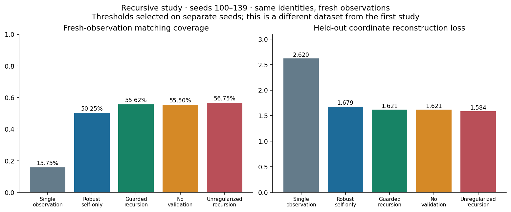
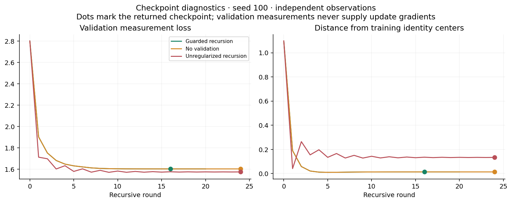
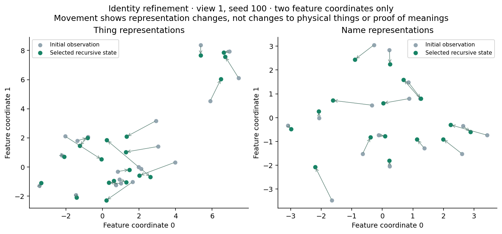

## Recursive Grounding: representation refinement with explicit anti-overfitting controls

Research prototype v2 supplement · October 15, 2026 · R. Michael Glover

### R1. The added recursion

The new module recursively revisits a finite three-level hierarchy: observation leaves, thing/name representations, and reciprocal relation hypotheses. Relations feed back into representations; updated representations regenerate the relation graphs and label evidence at the next round. This is GRRLE-inspired recurrent refinement, not a port of the generic span-lattice implementation or an infinite-depth construction. Things becoming more like themselves means more stable representations of repeated measurements. Names becoming more like things means revising their feature representatives toward supported referents. The physical things themselves are not modified.

Each direction retains a separate sensor space. Let X and W denote current thing and name coordinates, with X0 and W0 their coordinate-wise median training observations. Let C contain geometric-mean strengths only for mutually accepted pairs that persist over two consecutive rounds. All other entries are zero. Proposals are:

```text
T_X = (lambda X0 + beta C W) / (lambda + beta row_sum(C))
T_W = (lambda W0 + beta transpose(C) X) / (lambda + beta column_sum(C))
X_next = project_ball(X0, radius, X + damping * (T_X - X))
W_next = project_ball(W0, radius, W + damping * (T_W - W))
```

Division is row-wise. Unsupported rows fall back to their original training identity center. Default lambda=1, beta=0.25, damping=0.45 and radius=0.8. Both sides update simultaneously from the previous state. The initial state is the first training observation; the initial checkpoint may lie outside the proposal drift bound. Every later bounded proposal lies within radius 0.8 of its fixed training center. Input evidence is copied and never overwritten.

### R2. Overfitting is explicitly combatted

The guarded configuration uses robust within-identity medians, fixed identity anchoring, damped updates, a total displacement bound from the original centers, two-round persistence before cross-feedback, retained unknown labels, a finite 24-round budget, and validation checkpoint selection. After four rounds without a validation-loss improvement above 1e-5 it stops and returns its best checkpoint, including the possibility of returning round zero. Validation coordinates affect only checkpoint selection and stopping, never proposal coordinates, matching labels, or gradients. Repeated selection on finite validation data can itself overfit; these controls are not a guarantee against it.

A separate final matching gate requires three fresh logit-perturbation checks. Once relations feed back into both sides, their later agreement is coupled evidence and must not be counted as independent confirmation. Recursion is not an independent verifier and does not promote its own confidence to external truth.

### R3. Separate observations and separate questions

Each synthetic identity has five training measurements, three checkpoint-validation measurements, and three sealed test measurements per sensor view. There are 20 things (four unmatched), 16 name identifiers, five dimensions, thing noise standard deviation 0.9, and name noise standard deviation 0.7. Prototypes and unknown distractors use the same generating distributions as v1. The same identities recur across these splits: this tests fresh observations, not unseen objects, words, semantic categories, or languages.

The checkpoint objective is mean squared distance from both sets of representation coordinates to validation measurements of those same identities. It does not receive hidden thing-to-name correspondence labels. Held-out coordinate loss uses test measurements; latent mean-square error is an additional evaluation-only diagnostic in JSON. Fresh-observation matching uses the mean of each thing's three sealed test measurements against learned name representatives. It deliberately does not use the fitted thing coordinates as query inputs. The test observations never enter recursion, stopping, or threshold selection.

Seeds 0–19 select matching thresholds separately for each method on independent observations, targeting empirical accepted accuracy of at least 95% with ten accepts on the same grid as v1. Thresholds are frozen for seeds 100–139 under three conditions. Within each seed, checkpoint-validation measurements are distinct from that cross-seed threshold-calibration cohort. Neither validation procedure consumes the sealed test observations. Test tables contain 800 things per condition. CSV has 600 seed/method/condition rows; accuracy intervals use the same whole-seed bootstrap as v1.

The single-observation baseline uses the first training leaf. Robust self-only uses the medians of all five training leaves, with no cross-feedback. This same-evidence baseline separates recursive cross-refinement from merely acquiring more measurements. No validation runs all 24 rounds with identity constraints retained. Unregularized recursion removes the self anchor, drift bound, persistence and checkpoint selection, uses beta=1 and damping=0.9, and runs 24 rounds. It is a bundled stress ablation, not an isolated estimate of any one guard's contribution. The no-validation ablation isolates checkpoint selection more closely.

### R4. Measured recursive results

Independent observations, fresh test queries, frozen calibration thresholds:

| Method | Accepted accuracy | Coverage | Test coordinate loss | Mean returned round |
| --- | --- | --- | --- | --- |
| Single observation | 99.21% | 15.75% | 2.6201 | 0.0 |
| Robust self-only | 99.50% | 50.25% | 1.6792 | 0.0 |
| Guarded recursion | 99.33% | 55.62% | 1.6208 | 11.1 |
| No validation | 99.55% | 55.50% | 1.6207 | 24.0 |
| Unregularized recursion | 99.34% | 56.75% | 1.5839 | 24.0 |



Guarded recursion reaches 99.33% accepted accuracy at 55.62% coverage, compared with 99.50% at 50.25% for robust self-only. The coverage difference is 5.38 percentage points. Coordinate loss changes from 1.6792 to 1.6208. These results are for a different repeated-measurement dataset from v1; comparisons with v1's 98.80% result are not controlled comparisons.

The guard ablations are mixed. No-validation and unregularized recursion are competitive on this small dataset; unregularized recursion can obtain lower coordinate loss. Thus these experiments demonstrate implemented safeguards and a denoising/refinement effect, but do not prove that every guard improves accuracy, that guarded recursion is optimal, or that recursion universally prevents overfitting. Hyperparameters were not tuned to make a guard win on these test seeds. More noise regimes, sensor biases, capacities and independent datasets are required.



Training-outlier stress corrupts the first training measurement of a quarter of identities with Gaussian noise of standard deviation 5, leaving other measurements and validation/test splits unchanged. Robust self-only already provides much of the protection. Shared-wrong-dictionary stress applies the same cyclic wrong naming convention to both views, including their name observations. Coordinate validation can favor that internally consistent representation without recovering the intended correspondence.

| Condition | Guarded accepted accuracy | Coverage | Test coordinate loss |
| --- | --- | --- | --- |
| Training outliers | 99.06% | 53.12% | 1.6742 |
| Shared wrong dictionary | 0.00% | 52.50% | 1.6229 |



The plots show a representative seed rather than asserting that a single trajectory represents every run. Full histories, selected rounds, representation coordinates, counts, uncertainty intervals and source hashes are downloadable. Checkpoint traces end when the corresponding guarded run stops; no average over a changing set of surviving runs is plotted.

### R5. Verification, limits and reproduction

Tests cover deterministic refinement, non-mutation, finite normalized inference, bounded post-initial proposals, validation rollback, finite recursion, self-only behavior, persistence, input validation, and separation of validation from the proposal path. A successful coordinate checkpoint is not a proof of semantic truth. Unknowns remain an explicit abstention option, and the unique-instance matching assumption remains in force.

Run recursive_experiment.py, build_recursion.py and build_report.py from the repository root. The first script records its configuration, exact seed splits, library versions, hashes and complete histories. Plotting and report tools are separate from the NumPy runtime. Interactive depth controls inspect stored checkpoints and do not run hidden training or alter the frozen study. The existing GRRLE Strong exhibit documents the broader recursive design; this module is a small specialized recurrent hierarchy, not a port of that implementation.

A next study should preregister architecture and stopping choices, vary validation-set size, hold out entire identities and semantic categories, and test many-to-many naming. Independent measurements or a separate verifier are still required before treating a recursively reinforced relation as a provisional external fact.
