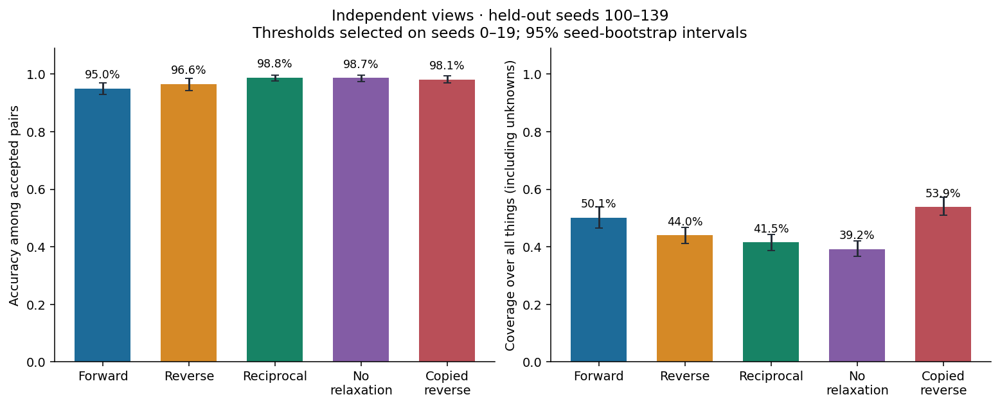
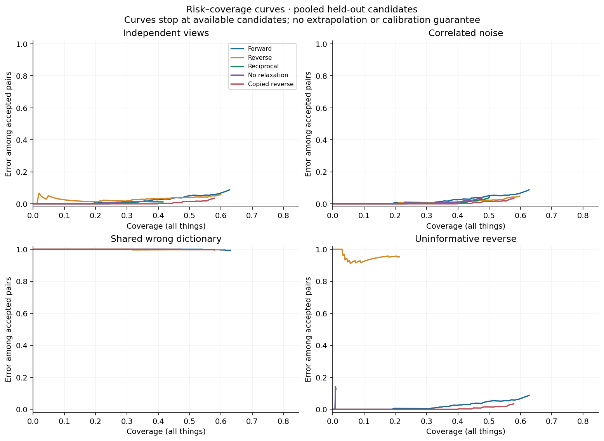
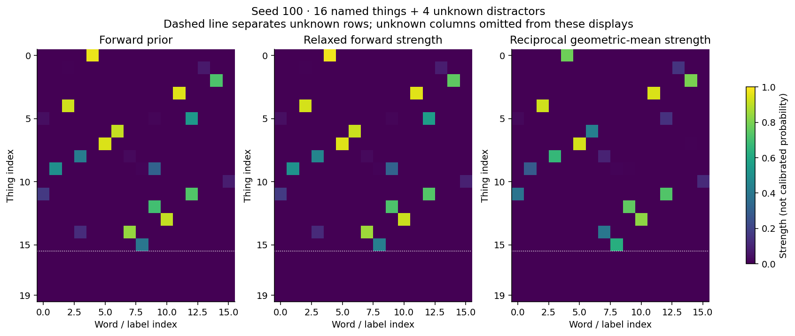

# Reciprocal Grounding
## Things as objects, words as objects, agreement as provisional ground truth

R. Michael Glover · HRL Portfolio · October 15, 2026 · Research prototype v2: original study plus recursive supplement

### Abstract

We implement a proposal in which things receive word labels in one experiment, while words receive thing labels in another. Independently supplied evidence is relaxed in each direction. Mutual unique winners, two directional strength thresholds, margins, and perturbation stability define a conservative acceptance rule. Accepted pairs are candidates for provisional ground truth, subject to a separate audit and revocation. On a synthetic instance-matching benchmark with unknown distractors, reciprocal acceptance achieves 98.80% accuracy at 41.50% coverage on held-out independent-view seeds. Forward-only acceptance achieves 95.01% at 50.12%. These are different operating points, not a controlled claim of superiority. A shared wrong dictionary produces 0 correct pairs among 338 reciprocal accepts. A copied-reverse baseline also performs strongly, demonstrating that mutual uniqueness can filter errors without adding independent evidence. Results support further testing of reciprocal selection, not a general truth-discovery guarantee or a novelty claim.

### 1. Proposal and scope

The motivating proposal is to exchange the roles of objects and labels: names classify things, then things classify names. Where differently informed experiments agree, promote the relationship to a revisable anchor. This report operationalizes a narrow version: unique word identifiers and distinct thing instances with a one-to-one hidden correspondence, plus unmatched things. It does not resolve natural-language meaning, synonyms, polysemy, or many instances sharing a class name. Those require a broader relation model.

Ground truth in this experiment is the simulator's hidden generating assignment. Provisional ground truth in the proposed workflow is a stored, evidence-backed working assignment. Neither internal coherence nor the score alone is treated as external truth.

### 2. Two separate relaxation problems

Let F have shape n by (m+1), assigning words to things; let R have shape m by (n+1), assigning things to words. Each final column represents unknown. Each direction receives its own logits L, an object relation graph A, and a label relation graph B. Both graphs are nonnegative, have zero diagonals, and are row-normalized; isolated rows remain zero. Starting at softmax(L), use the damped update:

```text
S = A @ P_real @ transpose(B)
P_next = (1-d) P + d softmax(L + g [S, 0])
```

Here d=0.5 and g=2.0. The fixed prior logits are respected at every update; the unknown label receives no graph reinforcement. Stop at maximum absolute change below 1e-7 or 80 iterations. This is a graph-factorized relaxation variant, separate from the existing four-index HRL engine. It is not asserted to reproduce that engine's update. Nonnegative finite strengths and row normalization are enforced. Convergence on these runs is reported, not proved for arbitrary graphs.

### 3. Reciprocal acceptance and audit

For a proposed pair (i,j), define the geometric-mean score:

```text
agreement(i,j) = sqrt(F[i,j] * R[j,i])
```

Accept only if j is thing i's unique strongest label, i is word j's unique strongest label, neither winner is unknown, both strengths meet threshold tau, both winning margins exceed 0.06 including the unknown competitor, and the same mutual winners survive three logit perturbation runs. Scores rank candidates; the threshold gates each direction separately. The score is not a calibrated probability. No Bayesian independence claim follows from multiplying strengths.

Perturbations add Gaussian noise of standard deviation 0.12 to the original logits, keep the relation graphs fixed, and rerun relaxation. This tests small numerical/evidence perturbations, not independent observations or resistance to all distribution shifts. The unrelaxed ablation uses the same perturbation draws.

The audit API accepts a separate verifier and emits candidate, rejected, or revoked provenance records. The representative example uses the simulator's hidden labels as an oracle solely to demonstrate this interface. That oracle is not available to a real grounding system and is not used for fitting or selection. The anchor_logits helper can add a bounded logit bonus to audited pairs in both directions, starting each round from fresh base evidence. Revoking a pair removes its bonus on the next fresh rebuild; conflicting one-to-one anchors are rejected. Sharing anchors couples the views, so subsequent agreement is not fresh independent confirmation. The original study does not feed pseudo-labels back automatically, benchmark multiple anchor-growth rounds, or guarantee an independent real-world verifier. The recursive supplement adds a separately benchmarked representation-refinement loop.

Mutual unique winners imply that no two accepted things share one word, and no accepted thing has two words. This is an acceptance restriction, not a learned general semantic principle. A stable, confident wrong permutation satisfies every reciprocal test: agreement cannot by itself establish correctness.

### 4. Benchmark protocol

Each seed generates 16 latent word prototypes in five dimensions, with coordinates drawn from a zero-mean normal distribution of standard deviation 1.4. Sixteen things are a hidden permutation of those prototypes; four unmatched things come from a distant normal distribution with mean 6 and standard deviation 1. Observations of each thing receive Gaussian noise of standard deviation 0.65; word prototypes receive noise of standard deviation 0.25. Label logits are negative squared Euclidean distance divided by twice 0.65 squared. Unknown has fixed logit -4. Relation weights are exp(-squared-distance/10).

The synthetic dimensions are feature channels, not real words or measured objects. Separate view noise is drawn independently conditional on the shared latent construction. This does not establish independence of final errors, since the underlying instance identities and geometry are shared.

Four conditions are fixed in advance of this report: independent views; thing-observation noise correlated at 0.95; both word dictionaries cyclically shifted by the same incorrect permutation; and an uninformative reverse view drawn independently of the true matching. The copied-reverse ablation transposes the forward real-label strengths, appends null weight 0.03, and row-normalizes. It contributes no independent evidence. All methods retain unknown handling, margin tests, and matched logit-perturbation stability where applicable.

Seeds 0–19, only in the independent-view condition, select each method's threshold separately on a grid from 0.20 through 1.00 in steps of 0.025. Choose maximum validation coverage subject to empirical accepted accuracy at least 95% and at least 10 accepts; otherwise use threshold 1. This validation target is not a finite-sample risk guarantee. Freeze thresholds and evaluate seeds 100–139 in each condition. Per condition there are 800 things, including 160 unmatched distractors. Confidence intervals resample 40 whole seeds with replacement 1,000 times, preserving within-seed dependence; they are percentile intervals, not guarantees. Run-level counts are published as CSV.

### 5. Measured results

Independent views, frozen validation-selected thresholds:

| Method | Accepted accuracy | Coverage | Correct / accepted | Accuracy 95% interval |
| --- | --- | --- | --- | --- |
| Forward | 95.01% | 50.12% | 381/401 | 92.97%–96.88% |
| Reverse | 96.59% | 44.00% | 340/352 | 94.20%–98.58% |
| Reciprocal | 98.80% | 41.50% | 328/332 | 97.58%–99.70% |
| No relaxation | 98.73% | 39.25% | 310/314 | 97.44%–99.69% |
| Copied reverse | 98.14% | 53.87% | 423/431 | 96.87%–99.30% |



The reciprocal rule rejects more items than the forward baseline while making fewer errors among those accepted. Its accuracy interval overlaps other strong methods. The copied-reverse baseline has both a strong accuracy and larger coverage here; it cannot be interpreted as independent confirmation. The small difference between reciprocal selection with and without relaxation does not establish a general benefit from the graph update. No parameter sweep or external benchmark validates that benefit.

For a coverage-sensitive comparison, the published risk–coverage curves rank eligible pairs by each method's score and plot observed error versus accepted fraction. Curves end at the available candidate count; no missing coverage is fabricated. These pooled descriptive curves are not calibrated operating policies and have no simultaneous confidence bands. Comparing only the chosen threshold operating points would confound accuracy with abstention.

Reciprocal stress results under the same frozen threshold:

| Condition | Accepted accuracy | Coverage | Accepted |
| --- | --- | --- | --- |
| Correlated noise | 95.76% | 50.12% | 401 |
| Shared wrong dictionary | 0.00% | 42.25% | 338 |
| Uninformative reverse | 87.50% | 1.00% | 8 |



The shared wrong dictionary is the central counterexample: both directions can confidently agree on the wrong meanings. Correlated noise reduces the protection provided by distinct views. An uninformative reverse view leaves very few accepts, so the accuracy estimate there is based on only a small sample. This is a loss of useful coverage, not successful broad grounding. Unknown acceptance counts are included in the JSON and CSV; correct abstention is not counted as a correct accepted correspondence.



The representative matrices show seed 100. Their unknown columns are omitted from the figure but retained in every decision and in the downloadable state. All 0 base-view nonconvergences are counted across the 320 held-out directional fits; zero here does not imply a general convergence theorem. Perturbation convergence is not included in that count.

### 6. Why agreement can help, and why it can fail

In an idealized categorical thought experiment, suppose two predictors each choose one of m labels. They are correct with probabilities a and b, their correctness events are independent, and each wrong prediction is uniform over the other m-1 labels and independent of the other predictor. Then:

```text
Pr(correct | agreement) = a*b / (a*b + (1-a)*(1-b)/(m-1))
Pr(agreement) = a*b + (1-a)*(1-b)/(m-1)
```

This follows by separating agreement into both-correct and same-wrong-label events. It is an explanatory special case, not a theorem about the implemented reverse mapping or its scores. Shared wrong-label preferences violate its assumptions. Two identical predictors obtain no independent corroboration by agreeing. Our shared-dictionary experiment makes the failure concrete.

### 7. Reproducibility and limitations

Run the experiment, plots, and report builders from the repository root. JSON stores parameters, seed ranges, thresholds, raw strengths for one example, base convergence diagnostics, environment versions, and SHA256 hashes of the engine and experiment script. CSV contains all 800 held-out seed/method/condition count rows. Reproducing on a different numerical runtime may change last-bit values and threshold-boundary outcomes. No claim of measurement outside the synthetic generator is made.

Limitations of this original study include a small synthetic benchmark, a strong unique-instance matching assumption, fixed dimensionality and noise scales, a coarse threshold grid, no external semantic dataset, no independent real-world verifier, no learning of relation graphs, no proof of convergence or calibrated confidence, and no multi-round anchor-feedback benchmark. Computational cost is increased by fitting two views and three perturbations of each. Dense graph products scale roughly as O(n^2*m+n*m^2) per update, with O(n^2+m^2+n*m) storage per direction; sparse graphs are future work. The separate four-index engine is not allocated here.

### 8. Relationship to prior work and next experiments

Relaxation labeling has a long history in context-dependent assignment, including Hummel and Zucker's foundational analysis [1]. Co-training uses distinct views and pseudo-label exchange [2]. Selective classification explicitly studies the trade-off between accepted prediction risk and coverage [3]. This prototype combines reciprocal role reversal, graph relaxation, abstention, perturbation checks, and an audit interface in the HRL portfolio. We do not claim those ingredients, the geometric mean, or the broad concept of two-view agreement are new. A systematic novelty assessment remains open.

Next experiments should use real referring expressions and physical observations; compare against mutual-nearest-neighbor matching and stronger assignment baselines; vary error correlation, object counts, graph quality and unknown rates; evaluate many-to-many relations; and run bounded anchor growth with genuinely separate evidence. Keep test labels hidden until final evaluation, measure both accepted error and coverage, and publish failures alongside gains.

### References

[1] R. Hummel and S. Zucker. On the Foundations of Relaxation Labeling Processes. IEEE TPAMI, 1983. https://doi.org/10.1109/TPAMI.1983.4767390

[2] A. Blum and T. Mitchell. Combining Labeled and Unlabeled Data with Co-Training. COLT, 1998. https://publications.ri.cmu.edu/combining-labeled-and-unlabeled-data-with-co-training

[3] Y. Geifman and R. El-Yaniv. Selective Classification for Deep Neural Networks. NeurIPS, 2017. https://papers.neurips.cc/paper_files/paper/2017/hash/4a8423d5e91fda00bb7e46540e2b0cf1-Abstract.html


## Recursive Grounding: representation refinement with explicit anti-overfitting controls

Research prototype v2 supplement · October 15, 2026 · R. Michael Glover

### R1. The added recursion

The new module recursively revisits a finite three-level hierarchy: observation leaves, thing/name representations, and reciprocal relation hypotheses. Relations feed back into representations; updated representations regenerate the relation graphs and label evidence at the next round. This is GRRLE-inspired recurrent refinement, not a port of the generic span-lattice implementation or an infinite-depth construction. Things becoming more like themselves means more stable representations of repeated measurements. Names becoming more like things means revising their feature representatives toward supported referents. The physical things themselves are not modified.

Each direction retains a separate sensor space. Let X and W denote current thing and name coordinates, with X0 and W0 their coordinate-wise median training observations. Let C contain geometric-mean strengths only for mutually accepted pairs that persist over two consecutive rounds. All other entries are zero. Proposals are:

```text
T_X = (lambda X0 + beta C W) / (lambda + beta row_sum(C))
T_W = (lambda W0 + beta transpose(C) X) / (lambda + beta column_sum(C))
X_next = project_ball(X0, radius, X + damping * (T_X - X))
W_next = project_ball(W0, radius, W + damping * (T_W - W))
```

Division is row-wise. Unsupported rows fall back to their original training identity center. Default lambda=1, beta=0.25, damping=0.45 and radius=0.8. Both sides update simultaneously from the previous state. The initial state is the first training observation; the initial checkpoint may lie outside the proposal drift bound. Every later bounded proposal lies within radius 0.8 of its fixed training center. Input evidence is copied and never overwritten.

### R2. Overfitting is explicitly combatted

The guarded configuration uses robust within-identity medians, fixed identity anchoring, damped updates, a total displacement bound from the original centers, two-round persistence before cross-feedback, retained unknown labels, a finite 24-round budget, and validation checkpoint selection. After four rounds without a validation-loss improvement above 1e-5 it stops and returns its best checkpoint, including the possibility of returning round zero. Validation coordinates affect only checkpoint selection and stopping, never proposal coordinates, matching labels, or gradients. Repeated selection on finite validation data can itself overfit; these controls are not a guarantee against it.

A separate final matching gate requires three fresh logit-perturbation checks. Once relations feed back into both sides, their later agreement is coupled evidence and must not be counted as independent confirmation. Recursion is not an independent verifier and does not promote its own confidence to external truth.

### R3. Separate observations and separate questions

Each synthetic identity has five training measurements, three checkpoint-validation measurements, and three sealed test measurements per sensor view. There are 20 things (four unmatched), 16 name identifiers, five dimensions, thing noise standard deviation 0.9, and name noise standard deviation 0.7. Prototypes and unknown distractors use the same generating distributions as v1. The same identities recur across these splits: this tests fresh observations, not unseen objects, words, semantic categories, or languages.

The checkpoint objective is mean squared distance from both sets of representation coordinates to validation measurements of those same identities. It does not receive hidden thing-to-name correspondence labels. Held-out coordinate loss uses test measurements; latent mean-square error is an additional evaluation-only diagnostic in JSON. Fresh-observation matching uses the mean of each thing's three sealed test measurements against learned name representatives. It deliberately does not use the fitted thing coordinates as query inputs. The test observations never enter recursion, stopping, or threshold selection.

Seeds 0–19 select matching thresholds separately for each method on independent observations, targeting empirical accepted accuracy of at least 95% with ten accepts on the same grid as v1. Thresholds are frozen for seeds 100–139 under three conditions. Within each seed, checkpoint-validation measurements are distinct from that cross-seed threshold-calibration cohort. Neither validation procedure consumes the sealed test observations. Test tables contain 800 things per condition. CSV has 600 seed/method/condition rows; accuracy intervals use the same whole-seed bootstrap as v1.

The single-observation baseline uses the first training leaf. Robust self-only uses the medians of all five training leaves, with no cross-feedback. This same-evidence baseline separates recursive cross-refinement from merely acquiring more measurements. No validation runs all 24 rounds with identity constraints retained. Unregularized recursion removes the self anchor, drift bound, persistence and checkpoint selection, uses beta=1 and damping=0.9, and runs 24 rounds. It is a bundled stress ablation, not an isolated estimate of any one guard's contribution. The no-validation ablation isolates checkpoint selection more closely.

### R4. Measured recursive results

Independent observations, fresh test queries, frozen calibration thresholds:

| Method | Accepted accuracy | Coverage | Test coordinate loss | Mean returned round |
| --- | --- | --- | --- | --- |
| Single observation | 99.21% | 15.75% | 2.6201 | 0.0 |
| Robust self-only | 99.50% | 50.25% | 1.6792 | 0.0 |
| Guarded recursion | 99.33% | 55.62% | 1.6208 | 11.1 |
| No validation | 99.55% | 55.50% | 1.6207 | 24.0 |
| Unregularized recursion | 99.34% | 56.75% | 1.5839 | 24.0 |


Guarded recursion reaches 99.33% accepted accuracy at 55.62% coverage, compared with 99.50% at 50.25% for robust self-only. The coverage difference is 5.38 percentage points. Coordinate loss changes from 1.6792 to 1.6208. These results are for a different repeated-measurement dataset from v1; comparisons with v1's 98.80% result are not controlled comparisons.

The guard ablations are mixed. No-validation and unregularized recursion are competitive on this small dataset; unregularized recursion can obtain lower coordinate loss. Thus these experiments demonstrate implemented safeguards and a denoising/refinement effect, but do not prove that every guard improves accuracy, that guarded recursion is optimal, or that recursion universally prevents overfitting. Hyperparameters were not tuned to make a guard win on these test seeds. More noise regimes, sensor biases, capacities and independent datasets are required.


Training-outlier stress corrupts the first training measurement of a quarter of identities with Gaussian noise of standard deviation 5, leaving other measurements and validation/test splits unchanged. Robust self-only already provides much of the protection. Shared-wrong-dictionary stress applies the same cyclic wrong naming convention to both views, including their name observations. Coordinate validation can favor that internally consistent representation without recovering the intended correspondence.

| Condition | Guarded accepted accuracy | Coverage | Test coordinate loss |
| --- | --- | --- | --- |
| Training outliers | 99.06% | 53.12% | 1.6742 |
| Shared wrong dictionary | 0.00% | 52.50% | 1.6229 |


The plots show a representative seed rather than asserting that a single trajectory represents every run. Full histories, selected rounds, representation coordinates, counts, uncertainty intervals and source hashes are downloadable. Checkpoint traces end when the corresponding guarded run stops; no average over a changing set of surviving runs is plotted.

### R5. Verification, limits and reproduction

Tests cover deterministic refinement, non-mutation, finite normalized inference, bounded post-initial proposals, validation rollback, finite recursion, self-only behavior, persistence, input validation, and separation of validation from the proposal path. A successful coordinate checkpoint is not a proof of semantic truth. Unknowns remain an explicit abstention option, and the unique-instance matching assumption remains in force.

Run recursive_experiment.py, build_recursion.py and build_report.py from the repository root. The first script records its configuration, exact seed splits, library versions, hashes and complete histories. Plotting and report tools are separate from the NumPy runtime. Interactive depth controls inspect stored checkpoints and do not run hidden training or alter the frozen study. The existing GRRLE Strong exhibit documents the broader recursive design; this module is a small specialized recurrent hierarchy, not a port of that implementation.

A next study should preregister architecture and stopping choices, vary validation-set size, hold out entire identities and semantic categories, and test many-to-many naming. Independent measurements or a separate verifier are still required before treating a recursively reinforced relation as a provisional external fact.
