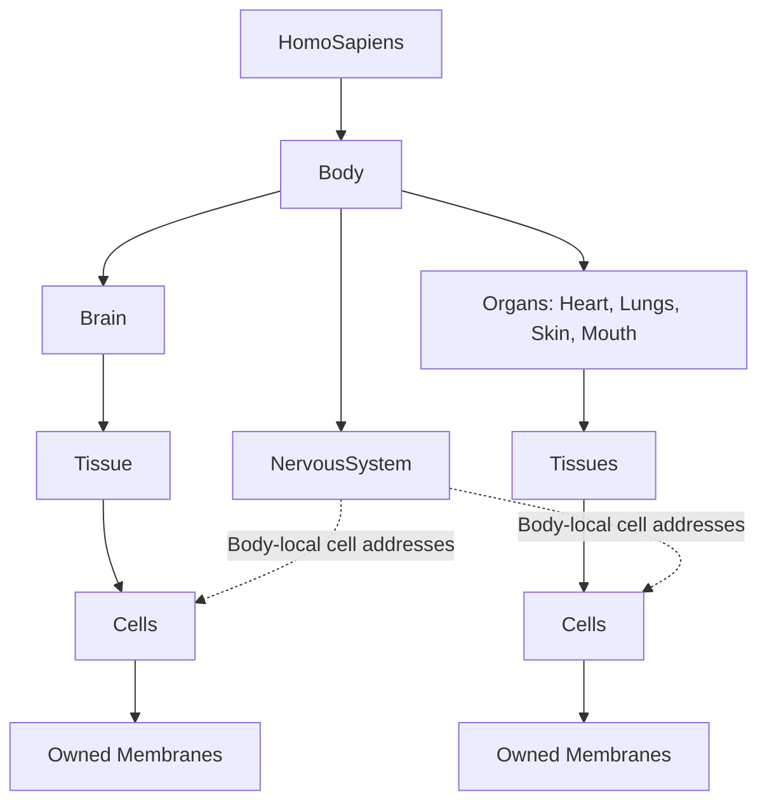

# A value-owned bioelectric Brain and Body

Originating framework and direction: **Michael Emanuel Glover**. C++ teaching,
implementation, numerical analysis and documentation developed with the assistant.

This increment adds electrical state to the existing `Cell`, a typed physical
`Brain`, and a routing `NervousSystem` to the existing `Body`. `HomoSapiens`
continues to own that same body. The existing cognitive `mind::Brain`, empirical
IMPase assays and enzyme-cycle models retain their distinct roles.

## Composition and responsibility



The example has five organ/region components, ten electrically modelled cells,
and six connections. Brain neurons and the sensory compartment use reduced
spiking membranes. Other compartments use passive membranes. Lungs aggregate
left/right structures here; Mouth names a composite region, not a claim that
all its tissues constitute one histological organ.

`Brain` owns an `Organ` internally through composition. The body owns that typed
Brain in `std::optional<Brain>` and other organs in `std::vector<Organ>`; organs
own tissues, tissues own cells, cells own their optional membranes. The optional
Brain supports existing partial-body examples; `make_body_example()` creates the
full composition used in this increment. It rejects adding a second Brain.

Connections contain `CellId` values: Brain/other-organ selector and local indices.
They never own or retain pointers/references to cells. Copying the body copies
cells, pending events and the graph; its local addresses resolve in the copy.
The API appends components without erasing/reordering them. External IDs are
coordinates relative to a particular body, not globally authenticated identities.

## Physical membrane law

```
C dV/dt = I_in + gL*(EL - V) + sum(g_syn*(E_syn - V))
```

C is picofarads, voltage millivolts, time milliseconds, inward current picoamps,
and conductance nanosiemens. Thus `pF*mV/ms = pA` and `nS*mV = pA`.
Each constructor checks finite values, positive capacitance and nonnegative
conductances. Under constant input/conductance, the RC voltage update is exact:

```
G = gL + sum(g_syn)
V_inf = (I_in + gL*EL + sum(g_syn*E_syn)) / G
V(t+dt) = V_inf + (V(t)-V_inf)*exp(-G*dt/C)
```

Zero conductance is handled separately as capacitive integration. The ideal
Nernst helper computes `1000*R*T/(z*F)*ln(outside/inside)` in mV, including anion
signs. It approximates activities by concentration ratios. It is a reference
calculation; the current demonstration uses explicitly declared effective leak
reversals rather than inferring them from unmeasured tissue ion concentrations.

Capacitance and Ohmic currents follow standard electrical laws. The conductance
approximation assumes an isopotential compartment and maintained reversal
potentials. Ion pools, pumps, extracellular volume and ATP use are not silently
inferred from this voltage model. Connecting them to the conserved biochemical
layer requires additional explicit accounting and measured parameters.

## Spikes, chemical synapses and numerical resolution

`SpikeRule` adds threshold, reset and refractory duration. This is a reduced
integrate-and-fire model; it does not generate an action-potential waveform.
The threshold crossing is solved analytically for the constant inputs in each
local interval. The unused part of the interval is retained through reset and
refractory handling, including multiple spikes in a long local interval.

A presynaptic event queues an arrival after its delay. Arrival increases a
postsynaptic conductance which decays exponentially. Synapses are excitatory or
inhibitory according to their reversal potential relative to the target voltage;
weights are nonnegative conductances. They are not voltage jumps or instantaneous
whole-body gap junctions.

The body uses synchronous intervals: deliver due arrivals, calculate each
synapse's interval-average conductance, evolve every membrane, and queue spikes
in timestamp order. Arrival delivery is rounded upward to the next interval
boundary; the average-conductance voltage solve is approximate for a changing
conductance. Defaults use a maximum 0.05 ms step; compare against 0.01 ms.
Neither exact isolated RC updates nor analytic threshold crossings make the
entire delayed network solve exact.

## Example protocol and its interpretation

A 350 pA inward-current pulse drives the Skin sensory compartment between
20 and 80 ms. Synthetic routing connects it to a Brain sensory relay, then a
Brain output relay, then four organ-labelled targets. This is a small causal
circuit, not a human connectome, an autonomic pathway reconstruction or a model
of cognition. Organ-level output at this stage is **membrane voltage**.
Heart pumping, lung gas exchange/breathing, skin mechanics and mouth movement
remain separate physiological problems; no such functions are claimed here.

The two Brain cells use C=100 pF, gL=5 nS and EL=-65 mV. The sensory compartment
uses C=50 pF and gL=5 nS. Passive targets have illustrative C/gL combinations:
Heart 150/5; Lungs 80/8; Skin 100/5; Mouth 100/6 (pF/nS). All begin at -65 mV.
Their differences illustrate electrical filtering, not organ-specific fitted
measurements. Threshold=-50 mV, reset=-65 mV, refractory=2 ms. Brain-path synapses
have 30 nS peaks and 4 ms decay; target synapses have 3 nS peaks and 5 ms decay.
Delays are 1–2 ms. The C++ factory specifies each connection.

Two perturbations distinguish mechanisms:

- Disconnecting routes preserves sensory spikes but removes downstream responses.
- Raising the sensory Brain cell's leak from 5 to 200 nS prevents that relay
  reaching threshold in this protocol. This is a chosen electrical stress test,
  not a disease diagnosis, lithium effect or clinically fitted parameter change.

The parameters and topology are illustrative. The law-based tests establish
implementation correctness under the stated model, not empirical human validity.
The earlier measured IMPase constants are not converted into electrical leak
conductances. Such a connection needs independent experiments.

## Results, checks and source

[Two-page figure report](BIOELECTRIC_BODY_REPORT.pdf) ·
[Body circuit](body-circuit.png) · [Physical references](physical-references.png) ·
[Machine-readable summary](summary.json) · [Recorded spikes](spikes.csv)

The generated summary records each scenario's spike counts, target-voltage peaks,
RC error, and time-refinement differences. The connected example produces
14 sensory, 21 Brain sensory and 25 Brain output spikes at both tested steps.
The highest sampled target-voltage difference between the two resolutions is
about 0.48 mV. The isolated C++ RC response matches its analytical solution to
floating-point precision. These are deterministic model results.

Eight CTest suites now include the pre-existing work and the bioelectric tests.
New checks cover constructor invariants, Nernst signs, analytical RC response,
parallel-conductance equilibrium, pure capacitance, recovery, firing intervals,
refractory hold, organ/cell ownership, valid routing, delayed arrival, copies and
moves with independent graph state, and immediate safe destruction. Additional
analysis checks exercise disconnected and high-leak controls and step refinement.
The five existing empirical-analysis Python checks remain available.

From the project root:

```sh
cmake -S . -B build
cmake --build build -j 2
ctest --test-dir build --output-on-failure
./build/bioelectric_demo
python3 experiments/bioelectric/analyze.py
python3 -m unittest discover -s experiments/impase -p 'test_*.py' -v
```

The C++ model needs only C++17/CMake. Plotting uses NumPy and Matplotlib.
Read [TUTORIAL.md](TUTORIAL.md) for the gradual ownership-to-physics lesson.

Official implementation references: [NEURON passive membrane tutorial](https://neuron.yale.edu/neuron/static/docs/tutorial/prog1b.html),
[Brian synapse tutorial](https://brian2.readthedocs.io/en/stable/resources/tutorials/2-intro-to-brian-synapses.html).
These support the modelling conventions; their software is not a dependency.

## Next empirical step

Estimate C and gL from a measured current-clamp response in a specified cell
preparation. Validate held-out pulse amplitudes and durations before adding
voltage-gated conductances, compartment geometry or biochemical modulation.
The architecture allows those additions without changing who owns each cell.
